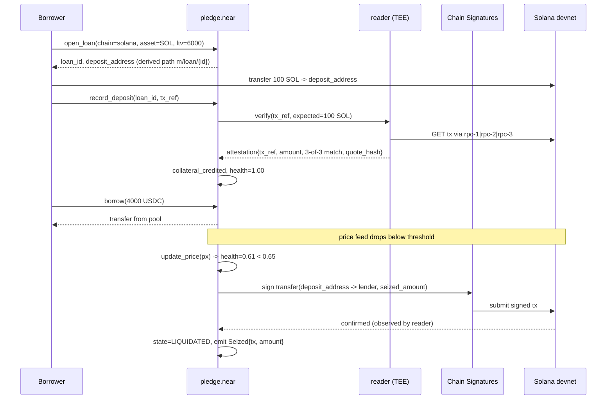
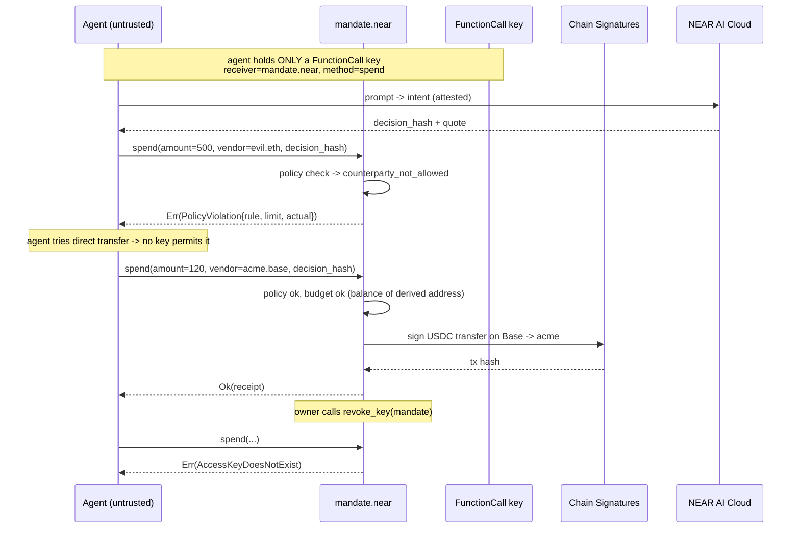

# ARCHITECTURE — Pledge & Mandate

> Two independent submissions, one shared trust model. Pledge is *what backs the spending*; Mandate is *who is allowed to spend*.
> Companion docs: `../BUILD_PLAN.md` (execution), `UNIQUENESS-AUDIT.md` (why this is defensible), `../PM-PACK/` (IAPM 01–17).
>
> **Status, 2026-11-06.** This file describes the system the two submissions target; it is
> not a description of what is committed. The built Mandate contract, console and tools are
> documented in `mandate/docs/ARCHITECTURE.md`, and where the two disagree the code wins.
> Concretely: the console is static and reads a contract snapshot (D-009) — it does not run
> the Next.js clients or workers drawn below; `revoke_key` is not a contract method, the
> in-band kill switch is `suspend`; and no testnet deployment exists yet (PENDING-HUMAN H-6).

---

## 1. Claim we build against

> A NEAR contract can **verify a fact about another chain**, **sign natively on that chain**, **settle against competing solver liquidity across 35+ chains**, and **keep the decision private and attested** — in one flow.

No other stack has all four. That composition, not "we invented spending limits", is the moat. See `UNIQUENESS-AUDIT.md` for the primitive-by-primitive proof and the wording we are *not* allowed to use.

---

## 2. Context diagram (C4-1)

```mermaid
graph TD
  Borrower["Borrower / agent owner<br/>(human, wallet)"] -->|deposit collateral, repay| Pledge
  Operator["Agent operator<br/>(company)"] -->|create mandate, fund, revoke| Mandate
  Agent["AI agent process<br/>(untrusted, may be injected)"] -->|spend(mandate, vendor, amount)| Mandate
  Judge["Judge / auditor<br/>(browser)"] -->|verify proof, replay demo| Console

  subgraph NEAR["NEAR mainnet / testnet"]
    Pledge["pledge.near<br/>loan state machine"]
    Mandate["mandate.near<br/>authority state machine"]
    Console["Next.js console"]
  end

  subgraph Ext["NEAR primitives"]
    MPC["Chain Signatures MPC<br/>11-of-17, Intel TDX"]
    Read["Read MPC<br/>3-of-5 RPC quorum"]
    Intents["NEAR Intents<br/>solver settlement"]
    AI["NEAR AI Cloud<br/>attested inference"]
    CKD["CKD<br/>app-bound key derivation"]
  end

  subgraph Chains["Foreign chains"]
    SOL["Solana devnet"]
    BASE["Base Sepolia"]
    BTC["Bitcoin testnet"]
  end

  Pledge --> MPC --> SOL
  Pledge --> MPC --> BASE
  Pledge --> Read
  Pledge --> Intents
  Mandate --> MPC --> BASE
  Mandate --> AI
  Mandate --> CKD
  Console --> Pledge
  Console --> Mandate
```

## 3. Container diagram (C4-2)

| Container | Tech | Responsibility | Trust level |
|---|---|---|---|
| `pledge` contract | Rust, `near-sdk` | loan lifecycle, LTV, liquidation trigger, proof registry | **trusted** (on-chain) |
| `mandate` contract | Rust, `near-sdk` | mandate policy, spend authorization, revocation, escalation | **trusted** (on-chain) |
| `reader` worker | TEE (dstack/OutLayer) + Python | fetch foreign state (3 independent RPCs), quorum, attest | untrusted host, attested output |
| `attestor` worker | TEE + NEAR AI Cloud | attested inference; emit decision hash + TDX quote | untrusted host, attested output |
| `signer` lib | TS + `near-api-js` | derive path, build foreign tx, request signature | stateless |
| `console` | Next.js 15, Tailwind v4 | borrower/operator UI, proof rail, red-team panel | public |
| `verifier` page | Next.js route | browser-side attestation verification | public |
| `replay` | Node script | deterministic demo runner (`make demo`) | dev only |

**Ports:** console `:3000`, worker `:8080`, verifier `:3001`, local NEAR sandbox `:3030`.

---

## 4. Pledge — loan lifecycle

### 4.1 Sequence: deposit → borrow → price drop → seize



### 4.2 State machine

```
CREATED → FUNDED → ACTIVE → (REPAID | LIQUIDATED | EXPIRED)
             ↑         ↓
             └── top_up / partial_repay
```

Invariants:
- `collateral_value * ltv_bps >= principal_outstanding` at every transition, else `liquidate` is permissionless.
- A seizure requires a valid `proof_id` for the collateral deposit **and** a fresh price with `age < max_price_age`.
- No state transition may be applied twice to the same `tx_ref` (`used_proofs` set).

---

## 5. Mandate — authority lifecycle

### 5.1 Sequence: injection refused, then killed



### 5.2 Policy object (hashed on-chain, human-readable in `MANDATE.md`)

```json
{
  "version": 1,
  "expires_at_block": 0,
  "budget": { "per_chain": { "base": "1200 USDC", "solana": "800 USDC" } },
  "limits": { "per_tx": "250 USDC", "per_day": "500 USDC", "per_counterparty_day": "150 USDC" },
  "allow": [{ "chain": "base", "to": "0xacme…", "label": "Acme Compute" }],
  "deny":  [{ "chain": "*", "to": "*", "reason": "default" }],
  "escalate_over": "250 USDC",
  "require_attestation": true
}
```

**Budget is a balance, never a comparison.** The derived address per mandate per chain holds the funds; the contract cannot overspend what it does not hold. This is deliberate — see `UNIQUENESS-AUDIT.md` §5 (ePrint 2026/2176 proves MPC-side budget comparison is bypassable).

---

## 6. Trust model

| Assertion | Who can break it | Mitigation | Residual risk |
|---|---|---|---|
| "This tx happened on Solana" | a lying RPC | 3 independent RPCs must agree; hash of all three stored | 3 colluding RPCs |
| "This code produced this decision" | worker operator | TDX quote verified in browser; code hash pinned on-chain | TEE vendor compromise |
| "Only the contract can move collateral" | MPC threshold | 11-of-17; no single operator holds a share | 11 colluding operators |
| "The agent cannot spend elsewhere" | agent runtime | FunctionCall key is scoped; no transfer permission exists | owner misconfigures policy |
| "Policy was not changed mid-flight" | mandate owner | policy hash chained; every spend records the hash it ran under | owner is trusted by definition |

**Never claim:** "trustless", "impossible to hack", "nobody can read it". CKD's own Trail of Bits review (Dec 2025, 2 High findings, published) makes absolute claims falsifiable in one search.

---

## 7. Threat model — executed, not written

The console ships a **red-team panel**; each row runs a real attack and shows PASS/BLOCKED with the tx hash.

| # | Attack | Expected |
|---|---|---|
| 1 | Prompt injection → foreign recipient | BLOCKED `counterparty_not_allowed` |
| 2 | Agent calls `transfer` directly | NO PATH (no key permits it) |
| 3 | 9 payments just under `per_tx` | BLOCKED at `per_day` |
| 4 | Replay the same `tx_ref` | BLOCKED `proof_already_used` |
| 5 | Tamper decision hash | BLOCKED `attestation_mismatch` |
| 6 | Forged TDX quote | BLOCKED `quote_invalid` |
| 7 | Revoke, then replay | BLOCKED `access_key_missing` |
| 8 | Liquidate with stale price | BLOCKED `price_stale` |
| 9 | Liquidate twice | BLOCKED `not_active` |

---

## 8. Configuration surface

`.env.example` (never commit real values):

```
NEAR_NETWORK=testnet
PLEDGE_CONTRACT=pledge.testnet
MANDATE_CONTRACT=mandate.testnet
MPC_CONTRACT=v1.signer.testnet
READ_MPC_URL=            # read-mpc endpoint, blank => 3-RPC quorum fallback
SOLANA_RPC_1=  SOLANA_RPC_2=  SOLANA_RPC_3=
BASE_RPC_1=    BASE_RPC_2=    BASE_RPC_3=
NEAR_AI_BASE_URL=https://cloud.near.ai
NEAR_AI_API_KEY=         # operator supplies; never in repo
INTENTS_DRY_RUN=true     # mainnet quotes only, tiny amounts
DEMO_SEED=42             # deterministic replay
```

**Feature flags** decide the honest fallback path at runtime and print it in the UI footer: `READ_MPC` vs `RPC_QUORUM`, `CKD` vs `TEE_SEALED`. The footer must never claim a path that is not active.

---

## 9. Repository layout

```
pledge/            separate public repo (one repo = one submission)
  contracts/pledge/       Rust
  workers/reader/         TEE verify + attest
  signer/                 derive + foreign tx build
  console/                Next.js
  demo/                   make demo
  docs/                   this file, README, SCREENER.md, DEMO.md

mandate/           separate public repo
  contracts/mandate/
  workers/attestor/
  agent/                  reference agent (deliberately injectable)
  console/
  demo/
  docs/
```

Shared code is **copied**, not imported: each repo must stand alone for the AI screener.

---

## 10. Performance and limits

| Path | Budget | Reality |
|---|---|---|
| `spend()` end-to-end | < 20 s | MPC latency dominates; TMAs are single-digit seconds |
| `record_deposit()` (3-RPC quorum) | < 8 s | parallel fetch, 5 s timeout + 1 retry |
| yield/resume window | ~200 blocks (~2 min) | fits one worker round trip; never used for human approval |
| console first paint | < 1.5 s | static export of demo data, live data streams after |

Human approval is a **separate on-chain flow** (`pending` → `approve`), not a yield/resume wait.
