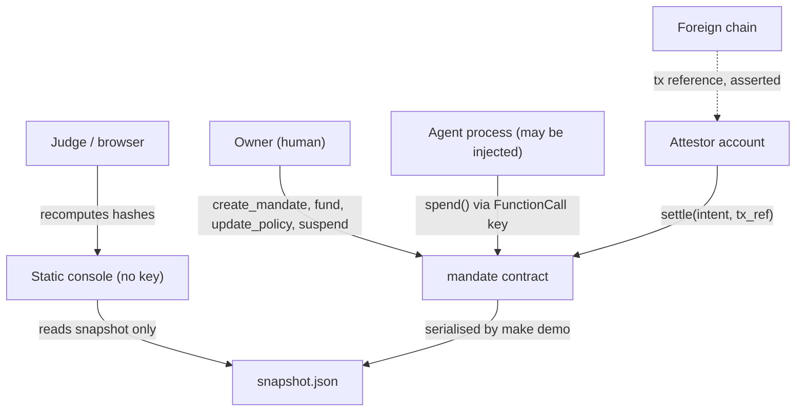
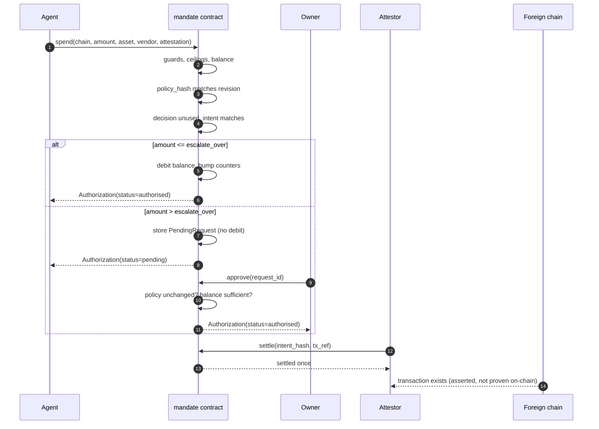
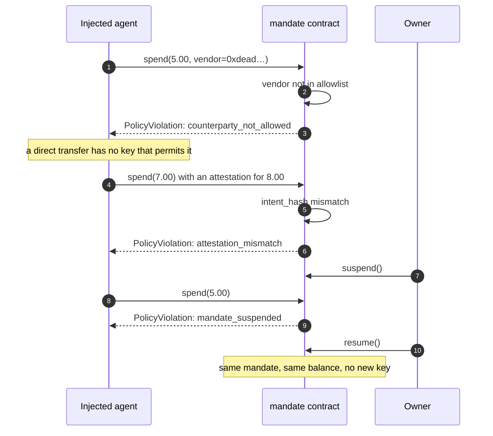
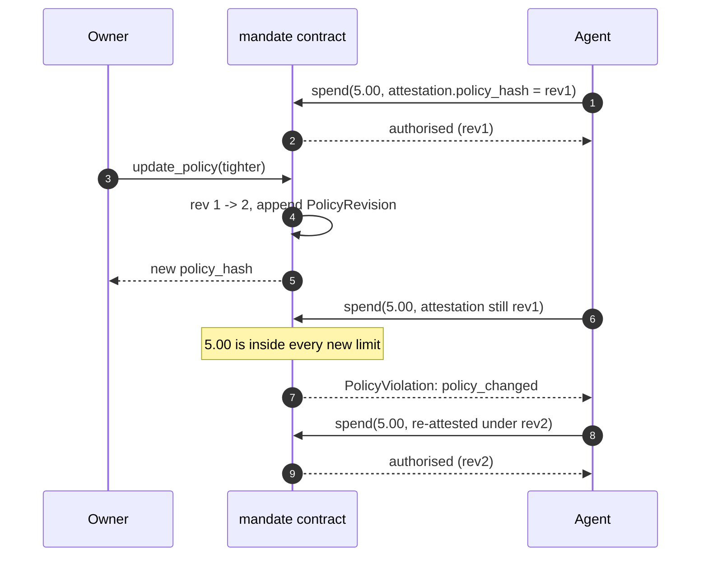
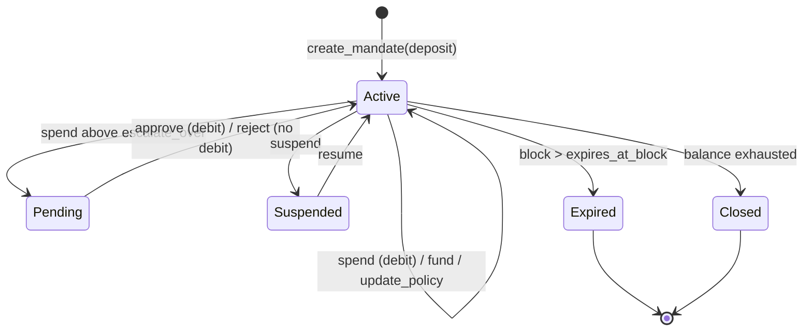
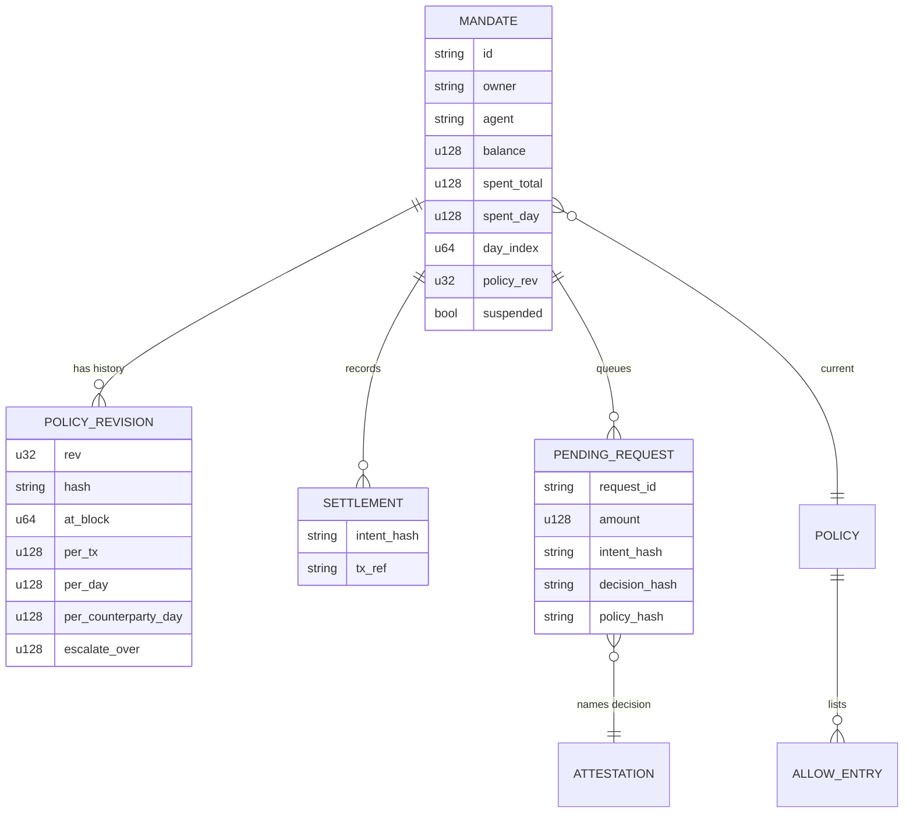
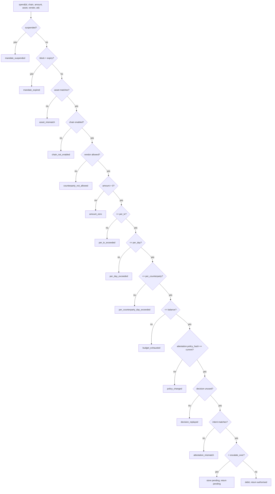
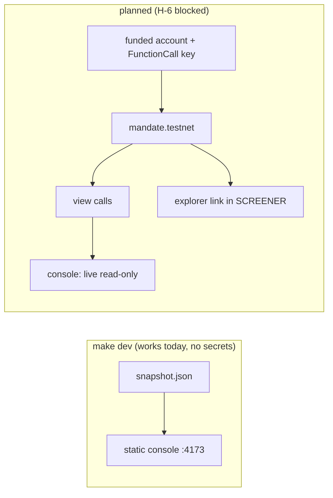

# UML and flow diagrams

> Mermaid blocks render on GitHub and in most editors. The console's **Paper**
> route shows the same diagrams as source, because a static, offline page cannot
> run a renderer without adding a dependency (D-012, D-016). The prose beside each
> diagram is the authoritative part; the picture is a convenience.

Contents: component view · spend sequence · refusal sequence · policy amendment
sequence · mandate state machine · data model · check order · deployment.

---

## 1. Component view

The console never writes and holds no key. The only writer paths are the three
accounts above; the only cross-chain fact in the system is the settlement
reference, which is asserted rather than proven.

---

## 2. Sequence: an authorised spend

---

## 3. Sequence: prompt injection is refused

---

## 4. Sequence: an amendment invalidates older decisions

This is demo events 13–15. It is also the reason `approve` re-checks the policy
hash: a request queued under revision 1 is refused after the amendment.

---

## 5. State machine

`Expired` and `Closed` are conditions evaluated at call time, not stored states:
the contract refuses with `mandate_expired` or `budget_exhausted` and leaves the
record readable. A suspended mandate never loses its balance or its counters.

---

## 6. Data model

The used-decision set is a flat map `decision_hash -> true`; it enforces "one
decision, one spend" across all mandates in the deployment.

---

## 7. Check order

---

## 8. Deployment

The local path is what a screener gets. The testnet path is written down with its
blocker rather than mocked.
